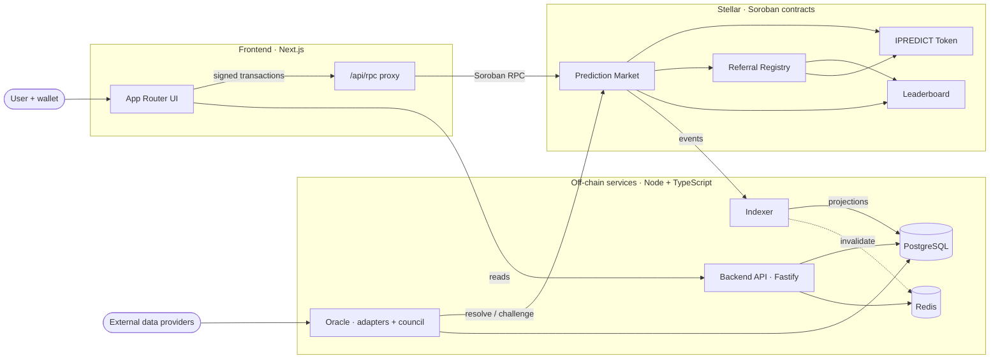

<p align="center">
  
</p>

<h1 align="center">iPredict - Prediction Market on Stellar</h1>

<p align="center">
  <a href="https://github.com/Akanimoh12/Stellar-iPredict/actions/workflows/ci.yml"></a>
  
  
</p>

**Predict. Win or Lose — You Always Earn.** Decentralized prediction market on Stellar with near-zero fees and 5-second finality.

- **Live app:** [ipredict-stellar.vercel.app](https://ipredict-stellar.vercel.app)
- **Demo video:** [Full MVP flow on Loom](https://www.loom.com/share/bbfa51fde81645eb9ca13eeba82bc695): wallet connect → browse markets → place bet → leaderboard → claim reward → referral

## Features

- **Binary prediction markets:** bet YES or NO on any question with XLM.
- **Everyone earns:** winners and losers both earn points and IPREDICT tokens.
- **On-chain referrals:** earn 0.5% of every referred bet, plus bonus points.
- **Low fees, fast settlement:** 2% total (1.5% platform + 0.5% referrer), 5-second finality.
- **Gasless betting:** fee sponsorship means users don't need XLM for transaction fees.
- **Non-custodial:** your wallet signs every transaction; the contracts hold the funds.

The reward and fee model is in [docs/CONTRACTS.md](docs/CONTRACTS.md#reward-system).

## Deployed Contracts (Stellar Mainnet)

| Contract | Address |
|----------|---------|
| Prediction Market | [`CDGNPRYTFDXJLWZE4YDKZXW4IEN2RLPSE4N7VM5HJ7NLPL2QC45GIXI5`](https://stellar.expert/explorer/public/contract/CDGNPRYTFDXJLWZE4YDKZXW4IEN2RLPSE4N7VM5HJ7NLPL2QC45GIXI5) |
| IPREDICT Token | [`CAYL4TKNRMXAX5ZLQGFEZ6XOC2QHTCTN5QC2SB5BEEHLVO6SDU2UBLRH`](https://stellar.expert/explorer/public/contract/CAYL4TKNRMXAX5ZLQGFEZ6XOC2QHTCTN5QC2SB5BEEHLVO6SDU2UBLRH) |
| Referral Registry | [`CAGJVX6EXMCKKWDJCQFIEJ34CZTHZOGLWJM6KQTGDEXEO723CJZ5773H`](https://stellar.expert/explorer/public/contract/CAGJVX6EXMCKKWDJCQFIEJ34CZTHZOGLWJM6KQTGDEXEO723CJZ5773H) |
| Leaderboard | [`CCWWOQSDSO3XXLCMA6A2HYRUFYVNUJZ2HPAMFQSPOB4JWYIBY2HWVTOB`](https://stellar.expert/explorer/public/contract/CCWWOQSDSO3XXLCMA6A2HYRUFYVNUJZ2HPAMFQSPOB4JWYIBY2HWVTOB) |

> **Admin:** `GDZ4VJWNJPLNU3PAWDYX3V5XNATO7X257DPHWRPFXSCCNEUZ7QTXIIUI` · **Native XLM SAC:** `CAS3J7GYLGXMF6TDJBBYYSE3HQ6BBSMLNUQ34T6TZMYMW2EVH34XOWMA` · All contracts are upgradeable.

The 30+ users who validated the product on testnet before launch are recorded in [docs/USER_VALIDATION.md](docs/USER_VALIDATION.md).

## Architecture



- **Contracts** (`contracts/`) hold funds and bets, resolve markets and pay out. They are the source of truth.
- **Frontend** (`frontend/`) builds transactions for the user's wallet to sign and reads data from the backend or directly over RPC.
- **Indexer** (`indexer/`) is the only writer of on-chain state into PostgreSQL. The database can always be rebuilt from contract events.
- **Backend** (`backend/`) serves the indexed data over HTTP, with Redis for caching and rate limits.
- **Oracle** (`oracle/`) gathers evidence from data providers, aggregates it, and submits or challenges resolutions on-chain.

Details, including the current versus target data paths, are in [docs/ARCHITECTURE.md](docs/ARCHITECTURE.md). The contracts and how they call each other are in [docs/CONTRACTS.md](docs/CONTRACTS.md).

## Quickstart

Requires Node.js 22+, Docker with Compose, and `make`. Rust is only needed to rebuild the contracts.

```bash
git clone https://github.com/Akanimoh12/Stellar-iPredict.git
cd Stellar-iPredict
git checkout implementation-drips

make install       # dependencies for every workspace
make env           # create missing .env files from the examples
make up            # Postgres + Redis
make migrate       # apply db/migrations
make seed          # sample markets, bets and leaderboard rows
make dev-backend   # then dev-indexer and dev-frontend, one terminal each
```

Open http://localhost:3000. Run `make test` for the Node suites, `make test-frontend` and `make test-contracts` for the others, and `make` on its own to list every target.

The [Quickstart](docs/QUICKSTART.md) walks through each step with a check. See also [Local development](docs/LOCAL_DEV.md) and [Troubleshooting](docs/TROUBLESHOOTING.md).

## Repository layout

| Path | Contents |
|------|----------|
| `contracts/` | Soroban smart contracts (Rust) |
| `frontend/` | Next.js app |
| `backend/` | Fastify read API |
| `indexer/` | Soroban event indexer |
| `oracle/` | Data adapters, council aggregation, submitter, monitor |
| `db/` | PostgreSQL migrations and seed tooling |
| `shared/` | Shared TypeScript types and event constants |
| `infra/` | Docker Compose, monitoring and deployment configuration |
| `status-page/` | Independently hosted status page |
| `docs/` | Design docs, runbooks and guides |

## Documentation

**Getting started**
- [Quickstart](docs/QUICKSTART.md) · [Local development](docs/LOCAL_DEV.md) · [Troubleshooting](docs/TROUBLESHOOTING.md) · [Contributor onboarding](docs/ONBOARDING.md)

**Design and reference**
- [Architecture](docs/ARCHITECTURE.md): system topology and data flows.
- [Smart contracts](docs/CONTRACTS.md): contract functions, call flow, rewards and fees.
- [Oracle and backend design](docs/ORACLE_AND_BACKEND.md): the design reference for the off-chain services.
- [API reference](docs/API.md): every HTTP endpoint, with rate-limit and caching behaviour.
- [Database schema](docs/DB_SCHEMA.md): the shared Postgres schema, with an ER diagram.
- [Glossary](docs/GLOSSARY.md): market, bet, outcome, bond, council and other terms.

**Operations**
- [Runbook index](docs/RUNBOOK_INDEX.md): **on-call starts here**; every alert mapped to its runbook.
- [Indexer runbook](docs/INDEXER_RUNBOOK.md) · [Oracle runbook](docs/ORACLE_RUNBOOK.md) · [Synthetic monitoring](infra/monitoring/synthetic.md) · [Status page](status-page/README.md)
- [Backend deployment](docs/BACKEND_DEPLOYMENT.md) · [Contract deployment](docs/DEPLOYMENT-GUIDE.md)
- [Backend and oracle security](docs/SECURITY_BACKEND.md): key custody, bonds and RPC trust.

**Project**
- [Contributing](CONTRIBUTING.md) · [Releasing and versioning](docs/RELEASING.md) · [Changelog](CHANGELOG.md) · [User validation](docs/USER_VALIDATION.md)

## Roadmap

| Phase | Timeline | Milestone |
|-------|----------|-----------|
| **Foundation** | Feb 2026 | MVP launch, testnet, core markets |
| **Growth** | Q2 2026 | User-created markets, oracle resolution, categories |
| **Token Utility** | Q3 2026 | IPREDICT staking, governance, reward tiers |
| **Scale** | Q4 2026 | Mainnet launch, mobile app, cross-chain bridges |

## Contributing

Work happens on the `implementation-drips` branch. Read [CONTRIBUTING.md](CONTRIBUTING.md) for the workflow, the pre-PR checks and how to record changes in the [changelog](CHANGELOG.md). All contributors follow the [Code of Conduct](CODE_OF_CONDUCT.md).

## Security

Found a vulnerability? **Do not open a public issue.** Report it privately
through GitHub's *Report a vulnerability* form on the Security tab. See
[SECURITY.md](SECURITY.md) for scope, response times and the disclosure process.

## License

Licensed under the [Apache License 2.0](LICENSE). Dependencies are restricted to permissive licenses; check them with `npm run license:check`.

## Author

Built by **Akan** for the Stellar Build-a-10M-Startup challenge.

- Stellar Admin Wallet: `GDHQ6TNWZ4V2JVCDWEUVW7YKFBXCOQZRRUCT27LAKES3PGOE6JSZMSMD`
