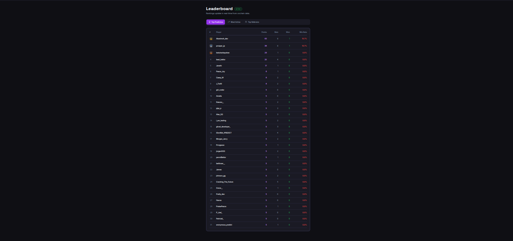

# User Validation

How iPredict was validated with real users before the mainnet launch, and what
changed as a result. This history was moved here from the README.

> The tables below record **pre-launch testnet validation**: 30+ real users who
> tested the full flow (bet, claim, referral) on Stellar Testnet before the
> mainnet launch. These are historical testnet wallets, kept as proof of product
> testing. Live mainnet activity is on the contracts listed in the
> [README](../README.md#deployed-contracts-stellar-mainnet).

## Pre-launch testnet users

| # | Wallet Address | Action | Points |
|---|----------------|--------|--------|
| 1 | `GDHQ6TNWZ4V2JVCDWEUVW7YKFBXCOQZRRUCT27LAKES3PGOE6JSZMSMD` | Admin — Created markets, placed bets, claimed rewards | 83 |
| 2 | `GA5OIFR4TLRJC54B3FIDWHIQKVFGVOWQFE3NXIIGCGLSGTJRUY6RHR2Q` | Placed bets, claimed rewards, referral registration | 38 |
| 3 | `GAIWJS35TTF2XMYGHY6AX6YBGI4IG3RWSEL2FEXV3DESW5RITGPWIIED` | Placed bets, claimed rewards, referral registration | 29 |
| 4 | `GA7GFCGUDLWZ6DIDCNERHA5CI7MATE6NT3MKDVJKFYIM5Y543OTLO3UY` | Placed bets, referral registration | 20 |
| 5 | `GDMA5FFWVJIOTBLO4XZWW5O4DWPOO33TLUOFCQQ7GPGTIRU6WXHCT4ZM` | Placed bets, referral registration | 17 |
| 6 | `GCSX2AGJRP747DWRCB3YYCKTXHU5CC6YNQUZPOCWWGA4DTK2PY5R6MUH` | Placed bets, referral registration | 8 |
| 7 | `GDKC2TFZVEJ7M7W2DLJZYFHK4AMHFX4JZKDP5JPQODBR7OT7C3RULXXA` | Placed bets, referral registration | 8 |
| 8 | `GAKY6JQSSCJZ3MQENCYAWIOZWGDKQJI7BCP6ZB35WTQZCMTYZ6M67UQG` | Placed bets, referral registration | 8 |
| 9 | `GCR32ST6YU3PLIOW7R6LRCB7ZMSSLAROMZGRQTK5CSOGW4GMIGMQGN5V` | Referral registration | 5 |
| 10 | `GA2LXPEKNP4IYZ2UKD4YUOGWPYMTNHGNXQRR2X3XT52XKQ5UV6BZKNFR` | Referral registration | 5 |
| 11 | `GCY4URAJ2JKE3UHCAEZHG5CTMVBS54S5IWQEWU3IIJX2ROOZ55YQYSOV` | Referral registration | 5 |
| 12 | `GDSSMRFIF56YMGR7DJY2DBQNQNLGJHJ5AW2DP3QSNVJVR4US6DTTM5YV` | Referral registration | 5 |
| 13 | `GB7M36KOEMNREMS4KMCXKUUYSHAT4JWEXLQJOFOEV3OA5SCUYYFEPGVO` | Referral registration | 5 |
| 14 | `GDD7MQAP2OE4NTEHLKNSUGIUMJN24RQL72ZTJAYGCDVULNP67JLUYGQW` | Referral registration | 5 |
| 15 | `GDUF4W7CEIM3JFGZFW4PTLWGCY3G3JD5P4WZMA4C6QFODLC7M6ASC3PU` | Referral registration | 5 |
| 16 | `GCXEQC2DIPFWPVR4JMROCYSB6YMP6TW3Q2YEV3IXTCRE4ZGSURKVL5LT` | Referral registration | 5 |
| 17 | `GBDFA2O72OOCUII5NWWKQ6G7V2EZ6D3GDWIYMCMQFVOAHFVAAM33ZOFZ` | Referral registration | 5 |
| 18 | `GACER5XK5SMHR64FZOELYPPLJVRWFBDY5UWCBOEBSLNK266Q2L45YD2P` | Referral registration | 5 |
| 19 | `GDKZYMCENO7VCOHIZRAV5OP26X5F6KV5ETT7L35WW6G7QWD4TVI72CXE` | Referral registration | 5 |
| 20 | `GCLS42CXE5GJGVNPBTF7YIJLI2QGO7LLZK5QFAGO7KPXRNQOLIUBZHFP` | Referral registration | 5 |
| 21 | `GAW5CACDFYE4T4U26IYYSEJTGXLU4HU5LREGTM4D5NLRPZSK5Y4YBVCE` | Referral registration | 5 |
| 22 | `GAWDCG7UCCJH4AOZPD45R4VPZG3XH7NVPIMZGNXT2BDKHMPRK6WSZXVV` | Referral registration | 5 |
| 23 | `GDQIMRXKQDDPXAAU6RQIXFG34GZPV2TEZWJTPE6IPSISG4P5GF5CZZ3B` | Referral registration | 5 |
| 24 | `GAEAQCVLZML7E74YYSA4VMACJWFZKABU774BDZ2PIOZC7QVQ3R3LKLPO` | Referral registration | 5 |
| 25 | `GAYU7KUVSIO2CQDMPN7GB62GTJTG73UYOBVO6RVV6WPOO45R2PTGABJI` | Referral registration | 5 |
| 26 | `GDJWQ5PBXYYRVQRMLZVRSKRCSJJBZNK2V7S5UN323JCUDK3D54YBUTM2` | Referral registration | 5 |
| 27 | `GCO7CTBLSFEGZKBYNWO34COSOON3FRAOM44HF23XLRV5QM72ZGV35ZL4` | Referral registration | 5 |
| 28 | `GBE663I55YXLC7U26GZBDUBHYXOYQFUXSXALDM2BXQRFUOPMFASGDGWQ` | Referral registration | 5 |
| 29 | `GBX3HFO3J6IPOXPH2BWPWKNSCFNMKGANMFJPBFC3JACIMBJM6UISGNZK` | Referral registration | 5 |
| 30 | `GASJLRNNMPYN3AIA6MFB6ETRDI5H5C36QRRXLFK62XZUJWGVK4YWNF6R` | Referral registration | 5 |
| 31 | `GBQI3WD2YKYUWB4MXOO3QP7DPENLV3WD32EHA43VV3US2DCBOWEPV7GW` | Referral registration | 5 |

## Leaderboard screenshot

*Pre-launch testnet wallets verifiable on [Stellar Expert Testnet Explorer](https://stellar.expert/explorer/testnet). Live mainnet contracts are linked in the [README](../README.md#deployed-contracts-stellar-mainnet).*

## Feedback

- **Form Link that I shared with users:** [https://forms.gle/WrTyoCzQ6LJegL8a9](https://forms.gle/WrTyoCzQ6LJegL8a9)
- **The Spreadsheet with feedback:** [https://docs.google.com/spreadsheets/d/1rGhq1rgeDPiF6hI4iDL2eFt0vUMBDA6LSm9zS2txpiA/edit?usp=sharing](https://docs.google.com/spreadsheets/d/1rGhq1rgeDPiF6hI4iDL2eFt0vUMBDA6LSm9zS2txpiA/edit?usp=sharing)

The full feedback log is in [notes/USER-FEEDBACK.md](notes/USER-FEEDBACK.md),
and the iteration history in [notes/ITERATION-LOG.md](notes/ITERATION-LOG.md).

## Feedback implemented

**Leaderboard filtering and sorting.** More filtering and default sorting options
were added to the leaderboard's Active view.

|*User Name*| *User Email* | *User Wallet Adddress* | *Commit ID*|
|----------------------|-------------------------|-------------------------|----------------|
| best_bettor | `tesinger96@gmail.com` | `GA7GFCGUDLWZ6DIDCNERHA5CI7MATE6NT3MKDVJKFYIM5Y543OTLO3UY` | `77c37784589046eeeb917a9015085dfa6fb26a52` |

**Loading states.** After initial testnet deployment, user feedback on loading states led to replacing spinner-only loading indicators with content-aware skeleton placeholders across leaderboard, profile, and market detail pages — improving perceived performance and reducing layout shift.

## Fee sponsorship (gasless transactions)

We added fee sponsorship (gasless transactions) to the MVP, allowing users to interact with the prediction market without needing to hold XLM for transaction fees. This significantly lowers the barrier to entry, enabling anyone to place bets and participate in the market seamlessly. The platform covers the transaction fees on behalf of the users, creating a more inclusive and user-friendly experience.
